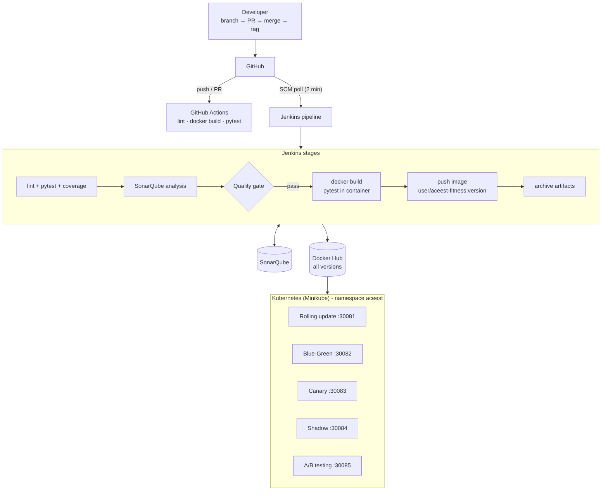

# ACEest Fitness & Gym - Assignment 2 Report
**Introduction to DevOps - CI/CD pipeline implementation**
Name: `<your name>` | Student ID: `2025tm93043` | Repository: https://github.com/2025tm93043/ACEestFitnessAndGym
Docker Hub: https://hub.docker.com/r/`<user>`/aceest-fitness | Endpoint(s): `<http://host:8081 … 8085>`

> Fill every `<…>` with your real evidence, delete lines that did not happen to you, and keep the
> final document to 2-3 pages. Add the screenshots from `docs/evidence/` as a short appendix (not counted in the pages).

## 1. CI/CD architecture overview



The application is a Flask service that grew through ten releases (v1.0 → v3.2.4: program catalogue, client
profiles, SQLite persistence, workouts/metrics/BMI, login, PDF reports, membership billing). Every release is a
Git tag. The delivery pipeline is:

```
Developer ─► GitHub (branch ─► PR ─► merge to main, tag vX.Y.Z)
               │  GitHub Actions: lint + Docker build + pytest in container (fast feedback on every push/PR)
               ▼
            Jenkins  (polls GitHub every 2 min)
               1 Checkout + lint + pytest with coverage (JUnit + coverage.xml)
               2 SonarQube analysis ─► quality gate (pipeline aborts if the gate fails)
               3 Docker image build (multi-stage) ─► pytest executed INSIDE the container
               4 Push <user>/aceest-fitness:<version> to Docker Hub
               5 Archive artifacts: source tarball per version, coverage, Sonar report
               ▼
            Kubernetes (Minikube) - pulls the images from Docker Hub
               rolling update | blue-green | canary | shadow | A/B testing, each with a rollback path
```

| Concern | Tool | Evidence |
|---|---|---|
| Version control | Git + GitHub: feature/infra/fix branches, PRs, tags per release | `git log --graph`, tags page |
| Unit testing | Pytest (`<n>` tests, `<xx>`% line coverage) | Jenkins test trend |
| Build automation | Jenkins declarative pipeline (`Jenkinsfile`) | Stage View |
| Code quality | SonarQube Community, quality gate enforced | `docs/evidence/sonarqube-report.md` |
| Containerisation | Docker multi-stage image: `base` → `test` → `runtime` (slim, non-root, healthcheck) | Dockerfile |
| Registry | Docker Hub, one tag per application version (+ `latest`) | Docker Hub tags page |
| Orchestration | Kubernetes on Minikube; manifests in `k8s/` | `kubectl get deploy,svc,pods` |

**Deployment strategies** (all in namespace `aceest`; `V_OLD=2.2.4`, `V_NEW=3.2.4`):
*Rolling update* (`maxUnavailable: 0` + readiness probe → zero downtime; automatic `rollout undo` if the rollout
does not become ready); *Blue-Green* (two Deployments, a Service selector switch gives an instant cut-over and
rollback); *Canary* (1 of 5 pods runs the new version ≈ 20 % of traffic, then promote or abort); *Shadow* (nginx
mirrors every request to the new version, its responses are discarded); *A/B testing* (nginx splits users 50/50
stickily, with a header/cookie override for testers).

## 2. Challenges faced and mitigation

| Challenge | Mitigation |
|---|---|
| The original application was a Tkinter desktop program that cannot run in a container or a CI server | Re-implemented the business logic as a Flask API in modules (`programs`, `clients`, `db`, `workouts`, `auth`, `reports`) keeping every release's functionality; charts became dependency-free SVG endpoints |
| One release dropped an import (`simpledialog` in the Tkinter 3.2.4; the same class of defect, a missing `random` import, appeared in the Flask port) | Lint (`flake8` F821) and the unit tests failed the pipeline; the fix was committed separately, which documents the quality gate working |
| Database schema changed between releases (height, goals, membership fields) | `db.py` migrates existing databases in place with `ALTER TABLE`, covered by tests |
| Jenkins could not use Docker (`permission denied` on `/var/run/docker.sock`) | Added the Jenkins user to the `docker` group / fixed socket permissions; the pipeline also supports Podman through `CONTAINER_CLI` |
| Strategies such as shadow and A/B need traffic control, normally a service mesh or ingress | Used a small nginx router per strategy (`mirror`, `split_clients`, `map`) configured through a ConfigMap - no extra platform needed; config was tested against real old/new app instances |
| Quality gate failures on first analysis `<delete if not true>` | `<describe what Sonar flagged, e.g. hard-coded default passwords, and how you fixed or reviewed them>` |
| Minikube NodePorts are on a private network | `scripts/expose.sh` forwards the five services to the host; firewall ports opened `<adjust>` |
| SQLite inside each pod is not shared | Accepted for the demo (stateless `emptyDir`); production would use a database service |

## 3. Key automation outcomes

- Every push to `main` is built, tested, scanned and packaged without manual steps; Jenkins history shows
  `<n>` consecutive successful builds on the latest commits.
- `<n>` unit tests run three times (locally/Jenkins, inside the container, in GitHub Actions) with `<xx>`%
  coverage; SonarQube quality gate: **`<Passed>`**, bugs `<0>`, vulnerabilities `<0>`, duplication `<x>`%.
- Every tagged application version (`1.0 … 3.2.4`, nine images; 2.1.2 is identical to 2.0.1) is published to
  Docker Hub, so any release can be deployed or rolled back by tag.
- Deployment is repeatable with one command (`scripts/k8s-deploy.sh all`); rollback takes seconds
  (`rollout undo`, selector switch, `canary.sh abort`) and a failed rolling update reverts itself.
- Measured: rolling update completed with `0` failed requests during the switch (`curl` loop printed only 200);
  canary split observed `<x>`/`<y>`; A/B split `<x>`/`<y>`; shadow service received mirrored requests while users
  saw only the live version.
- Build time from commit to published image: about `<n>` minutes.
